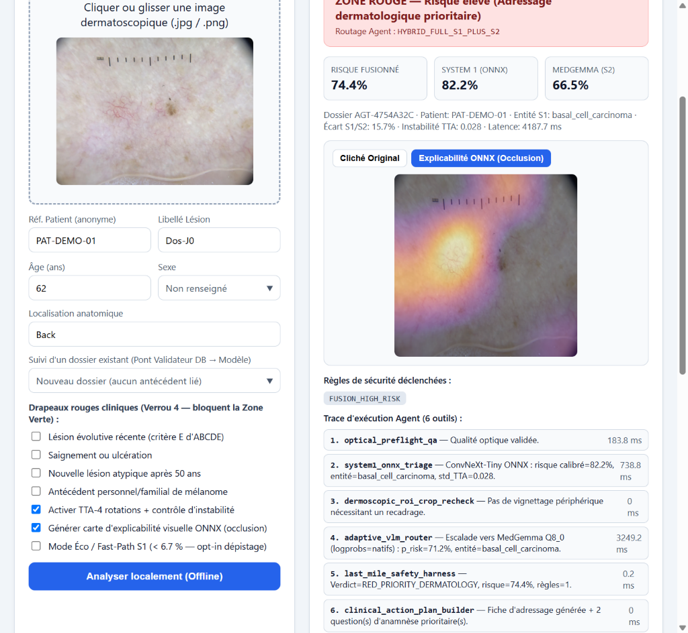
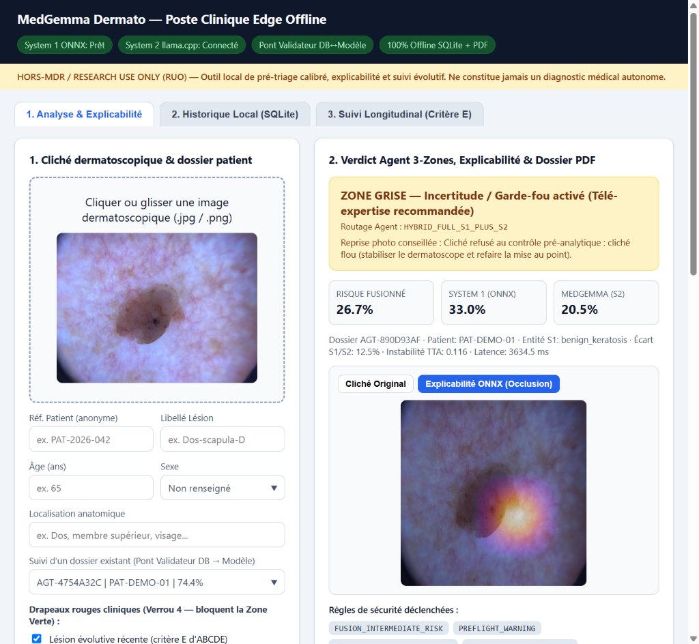
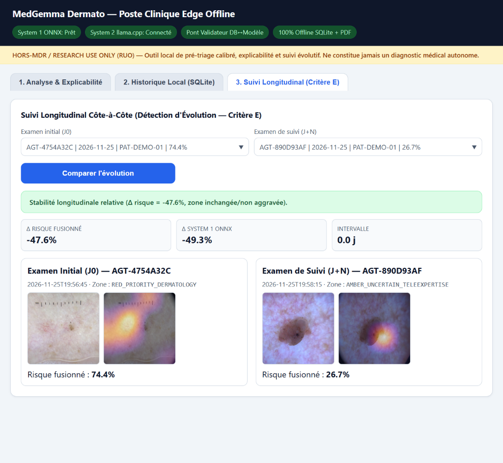
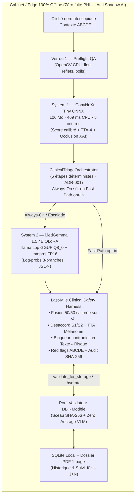

# MedGemma 1.5 4B — Hybrid Edge Dermoscopy & Last-Mile Clinical Safety Harness

> **Langue :** [English (README.md)](README.md) | **Français**  
> **Positionnement réglementaire — Research Use Only (RUO) & Hors-MDR :** Ce dépôt est un démonstrateur d'architecture IA santé (*pre-analytical QA*, pré-triage calibré, explicabilité visuelle et rédaction structurée de fiche d'adressage). Il ne constitue **pas** un dispositif médical (UE MDR Classe IIa) et n'émet aucun diagnostic clinique autonome. Les poids de base `google/medgemma-1.5-4b-it` sont soumis aux conditions **Google Health AI Developer Foundations (HAI-DEF)**.

Architecture hybride **100 % offline sur Edge** orchestrée par **`ClinicalTriageOrchestrator`** (pipeline déterministe borné à 6 étapes, voir [ADR-001](docs/ADR_001_deterministic_orchestration.md)) : **System 1 vision léger ONNX (`ConvNeXt-Tiny`, 5 centres)** + carte d'occlusion visuelle, **System 2 VLM médical (`MedGemma 1.5 4B QLoRA v1`, GGUF `Q8_0` avec `logprobs` 3-branches par règle de chaîne)**, **Pont Validateur Bidirectionnel SQLite ↔ Modèle (SHA-256 + anti-ancrage)**, et **Last-Mile Clinical Safety Harness à 6 verrous** évalué en aveugle sur **MSKCC Consecutive Biopsies 2020 (`n=200`)**.

---

## Aperçu Live du Poste Clinique Offline (RTX 4080 + SQLite + PDF)

| Onglet 1 : Zone Rouge + Explicabilité ONNX + Trace | Onglet 1 : Suivi via Pont Validateur DB↔Modèle | Onglet 3 : Suivi Longitudinal (Critère E) |
| :---: | :---: | :---: |
|  |  |  |

---

## 1. Architecture Système



---

## 2. Résultats clés sur le Hold-Out Externe Verrouillé (`MSKCC 2020`, `n=200`)

| Étape / Configuration | AUROC | Sens. Malins | Sens. Mélanome | Spécificité Zone Verte | NPV Zone Verte | ECE (cal.) | Contradictions bloquées | Gate CI/CD |
|---|---:|---:|---:|---:|---:|---:|---:|---|
| 1. MedGemma 1.5 Zero-Shot (Neutre) | — | `20.0 %` (`14/70`) | `17.9 %` (`7/39`) | `90.4 %` | — | `0.2950` | — | `BLOCK` |
| 2. MedGemma QLoRA v1 (BF16 Greedy, HIBA) | — | `75.7 %` (`53/70`) | `76.9 %` (`30/39`) | `52.2 %` | — | `0.1863` | — | `BLOCK` |
| 3. MedGemma QLoRA v1 (BF16 Règle de chaîne `@val95%`) | **`0.7096`** | `81.4 %` (`57/70`) | `82.0 %` (`32/39`) | `47.8 %` | `80.9 %` | `0.1959` | — | `BLOCK` |
| 4. System 1 `ConvNeXt-Tiny` ONNX (5 centres) | `0.6537` | `84.3 %` (`59/70`) | `87.2 %` (`34/39`) | `39.1 %` | `80.4 %` | `0.2280` | — | `BLOCK` |
| **5. Hybride BF16 (50/50) + Harness 3-Zones** | `0.6944` | **`95.7 %`** (`67/70`) | **`97.4 %`** (`38/39`) | **`30.4 %`** (`35/115`) | **`92.1 %`** | `0.1737` | **`43` (`14` cancers)** | **`PASS`** |
| 6. Edge `Q8_0` 1-Pass Logprobs + ONNX (RTX 4080) | `0.6920` | `91.4 %` (`64/70`) | `94.9 %` (`37/39`) | `27.8 %` (`32/115`) | `84.2 %` | `0.1676` | **`57` (`15` cancers)** | `BLOCK` |
| **7. Edge `Q8_0` 3-Branches Logprobs + ONNX (RTX 4080)** | `0.6976` *(S2 `0.7022`)* | `91.4 %` (`64/70`) | `94.9 %` (`37/39`) | **`30.4 %`** (`35/115`) | `85.4 %` | **`0.1594`** | **`52` (`15` cancers)** | **`BLOCK`** |

- **`Q4_K_M` rejeté en Sprint 4 :** conserve `100.0 %` de JSON valides mais s'effondre de **`-31.4 pts`** en sensibilité (`44.3 %` malins).
- **Suite Adversariale (`13/13 PASS`) & `47/47` tests unitaires/intégration verts** en CI GitHub Actions.

---

## 3. Quickstart Zéro-503 (Clone → Démo ou Inférence Complète)

```powershell
uv venv --python 3.12
uv pip install --python .venv\Scripts\python.exe -e ".[dev,edge]"
.venv\Scripts\ruff.exe check src scripts tests app && .venv\Scripts\pytest.exe tests -v

# Télécharger les poids ouverts System 1 ONNX (CC-0/CC-BY, 106 Mo — optionnel, Mode Démo Sandbox sinon)
.venv\Scripts\medgemma-dermato.exe download-system1

# Lancer le poste clinique offline (supervise llama-server Q8_0 + UI 3 onglets + SQLite + PDF)
.venv\Scripts\medgemma-dermato.exe serve --open
# Ou via Docker :
docker compose up --build
```
