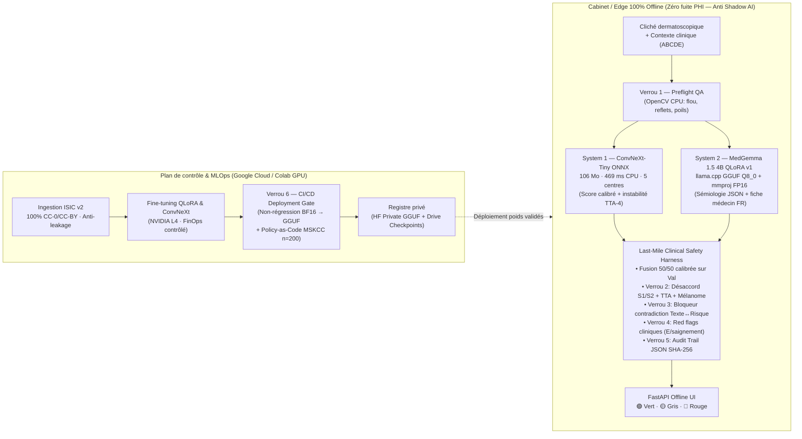
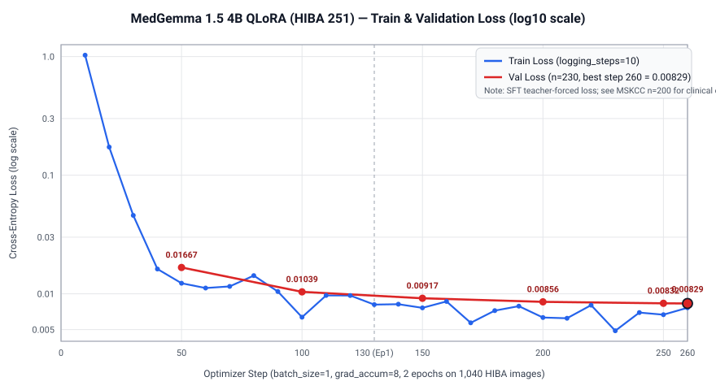
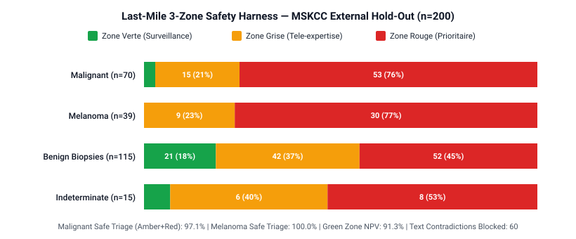

# MedGemma 1.5 4B — Hybrid Edge Dermoscopy & Last-Mile Clinical Safety Harness

> **Positionnement réglementaire — Research Use Only (RUO) & Hors-MDR :** Ce dépôt est un démonstrateur d'architecture IA santé (*pre-analytical QA*, pré-triage calibré et rédaction structurée de fiche d'adressage). Il ne constitue **pas** un dispositif médical (UE MDR Classe IIa) et n'émet aucun diagnostic clinique autonome. Les poids de base `google/medgemma-1.5-4b-it` sont soumis aux conditions **Google Health AI Developer Foundations (HAI-DEF)**.

Architecture hybride **100 % offline sur Edge** (PC de cabinet ou smartphone haut de gamme) combinant un **System 1 vision léger ONNX (`ConvNeXt-Tiny`, multi-centres)**, un **System 2 VLM médical fine-tuné (`MedGemma 1.5 4B QLoRA v1`, exporté en GGUF)** et un **Last-Mile Clinical Safety Harness déterministe à 6 verrous** évalué en aveugle sur un hôpital externe jamais vu (**MSKCC Consecutive Biopsies 2020, `n=200`**).

---

## 1. Architecture Système (Edge Clinique Offline + Boucle Cloud GCP)



---

## 2. Résultats clés sur le Hold-Out Externe Verrouillé (`MSKCC 2020`, `n=200`)

**Protocole anti-leakage strict :**
- `google/medgemma-1.5-4b-it` ayant intégré `40 269` exemples d'ISIC 2017/2018 `CC-0` au pré-entraînement, toutes les collections 2017/2018/HAM10000 sont exclues du test.
- Le jeu de test verrouillé (`data/isic_v1/test.jsonl`, **Collection 163 — MSKCC Consecutive Biopsies 2020**, `100 % CC-BY`, `0` ID pré-2019) contient **`70` malins** (`39` mélanomes dont `19` *in situ*, `19` SCC, `12` BCC), **`115` lésions bénignes 100 % biopsiées** (lésions mimétiques ayant déjà trompé des dermatologues experts : LPLK, lentigos solaires, SK atypiques, neurofibromes…) et **`15` indéterminées**.
- **0 image, 0 patient et 0 lésion MSKCC** en entraînement ou calibration. Tous les paramètres (`T`, `τ`) sont calibrés uniquement sur `val`.

### 2.1 Progression de bout en bout (Zero-Shot → QLoRA → Calibration → Hybride + Harness)

| Étape / Configuration | AUROC | Sensibilité Malins | Sensibilité Mélanome | Spécificité (Zone Verte) | NPV Zone Verte | ECE (cal.) | Contradictions texte bloquées | Gate CI/CD |
|---|---:|---:|---:|---:|---:|---:|---:|---|
| 1. MedGemma 1.5 Zero-Shot (Neutre) | — | `20.0 %` (`14/70`) | `17.9 %` (`7/39`) | `90.4 %` | — | `0.2950` | — | `BLOCK` |
| 2. MedGemma QLoRA v1 (Greedy, 1 centre HIBA) | — | `75.7 %` (`53/70`) | `76.9 %` (`30/39`) | `52.2 %` | — | `0.1863` | — | `BLOCK` |
| 3. MedGemma QLoRA v1 (Log-probs exacts `@val95%`) | **`0.7096`** | `81.4 %` (`57/70`) | `82.0 %` (`32/39`) | `47.8 %` | `80.9 %` | `0.1959` | — | `BLOCK` |
| 4. System 1 `ConvNeXt-Tiny` ONNX (`@mc_val95%`, 5 centres) | `0.6537` | `84.3 %` (`59/70`) | `87.2 %` (`34/39`) | `39.1 %` | `80.4 %` | `0.2280` | — | `BLOCK` |
| **5. Hybride 50/50 + Harness Dernier Kilomètre (3-Zones)** | `0.6944` | **`95.7 %`** (`67/70`) | **`97.4 %`** (`38/39`) | **`30.4 %`** (`35/115`) | **`92.1 %`** | **`0.1737`** | **`43` (dont `14` cancers)** | **`PASS`** |
| 6. Hybride 50/50 + Harness + Blocage strict Preflight QA | `0.6944` | **`97.1 %`** (`68/70`) | **`100.0 %`** (`39/39`) | `18.3 %` (`21/115`) | `91.3 %` | `0.1737` | **`60` (dont `15` cancers)** | `BLOCK` *(spec < 20 %)* |

> **Complémentarité réelle dans la zone clinique à haute sensibilité (`r = 0.61`) :** à sensibilité identique (`95.7 %`, `67/70` cancers), la fusion `50/50` atteint `33.9 %` de spécificité en oracle (`30.4 %` à l'aveugle) contre `22.6 %` pour MedGemma seul (`+11.3 pts`) et `15.7 %` pour System 1 seul (`+18.2 pts`). Sur la population de dépistage HIBA `val` (`n=230`), le harness complet atteint **`99.1 %` de sensibilité**, **`98.7 %` de NPV Zone Verte** et **`64.6 %` de spécificité Zone Verte**.

### 2.2 Sprint 4 — Quantification Edge GGUF & Détection de Régression Silencieuse (`mmproj` FP16)

| Modèle (`MedGemma 1.5 4B QLoRA v1`) | Taille totale (`+ mmproj FP16`) | JSON valide | Sens. Maligne Directe | Sens. Triage Sûr | Sens. Mélanome | Spécificité | Acc. Entité | Latence L4 | Statut Harness |
|---|---:|---:|---:|---:|---:|---:|---:|---:|---|
| `BF16 Merged` (PyTorch référence) | `~8.5 Go` | `100.0 %` | `61.4 %` | `75.7 %` | `76.9 %` | `52.2 %` | `22.0 %` | `7 583 ms` | Référence |
| **`GGUF Q8_0 + mmproj FP16`** | **`4.76 Go`** (`3.95 + 0.81`) | `99.5 %` | `60.0 %` | `70.0 %` (`-5.7 pts`) | `69.2 %` | **`61.7 %`** | **`27.5 %`** | **`2 784 ms`** (`2.7×`) | Plancher sûr min. *(avec S1+Harness : `91.4 %` mal / `92.3 %` mél)* |
| **`GGUF Q4_K_M + mmproj FP16`** | `3.19 Go` (`2.38 + 0.81`) | **`100.0 %`** | `32.9 %` | **`44.3 %` (`-31.4 pts`)** | **`43.6 %`** | `74.8 %` | `25.0 %` | `2 033 ms` (`3.7×`) | **REJETÉ / BLOQUÉ** *(effondrement clinique silencieux)* |

> **Enseignement clé IA Santé :** la quantification 4-bit (`Q4_K_M`) conserve **`100.0 %` de JSON syntaxiquement valides** et une ECE apparente propre (`0.164`), tout en provoquant une **chute catastrophique de `-31.4 pts` en sensibilité** (plus de la moitié des mélanomes manqués). Sans harness de non-régression clinique, cette dérive passerait totalement inaperçue. **`Q8_0 + mmproj-FP16` (`4.76 Go`)** est le plancher de quantification validé, et l'accès aux **log-probabilités continues** (plutôt que la confiance discrète générée en JSON) reste nécessaire pour franchir le gate strict `≥ 95 %`.

### 2.3 Courbes & Visualisations

| Entraînement QLoRA (`260` steps, L4) | ROC & PR Externe MSKCC (`n=200`) | Répartition 3-Zones Last-Mile Harness |
| :---: | :---: | :---: |
|  |  |  |

---

## 3. Benchmarks Edge CPU (Zéro PyTorch) & FinOps

- **System 1 ONNX (`system1_convnext_tiny_fp32.onnx`, `106.24 Mo`, parité PyTorch/ORT `4e-6`) :**
  - Latence réelle mesurée sur **CPU Windows local (`onnxruntime`)** : **`469 ms` (1-vue)** / **`973 ms` (TTA-4)**.
- **Dataset multi-centres System 1 (`data/system1_v1`) :** `6 822` images dermatoscopiques (`5 749` train / `1 073` val), **5 cohortes / 4 continents** (`HIBA` Argentine, `DERM12345` Turquie/UK, `ChileSK` Chili, `MEL-SELF` Australie, `Histopath-294` CC-0), **100 % licences commerciales (`CC-BY` / `CC-0`)**, **0 image MSKCC**.
- **Discipline FinOps :** ensemble du cycle (Zero-Shot + QLoRA 2 époques + Option C Calibration + System 1 12 époques + Merge/GGUF `Q8_0` & `Q4_K_M` + 400 inférences `llama-server`) exécuté sur NVIDIA L4 avec extinction systématique vérifiée (`0.00 CU/hr`).

---

## 4. Quickstart Local 100 % Offline (PC / Edge)

### Installation & tests (0 Compute Unit)

```powershell
uv venv --python 3.12
uv pip install --python .venv\Scripts\python.exe -e ".[dev,edge]"
.venv\Scripts\ruff.exe check src scripts tests app
.venv\Scripts\pytest.exe tests -v
```

### Lancer l'application clinique offline (`FastAPI` + `ONNX System 1` + `Last-Mile Harness`)

```powershell
# 1. (Optionnel) Démarrer System 2 MedGemma GGUF Q8_0 + mmproj FP16 en local via llama.cpp :
llama-server -m medgemma-dermato-v1-q8_0.gguf --mmproj mmproj-medgemma-dermato-v1-f16.gguf -ngl 99 -c 4096 --port 8080

# 2. Démarrer l'interface locale offline (fonctionne aussi en mode dégradé System 1 ONNX seul) :
.venv\Scripts\uvicorn.exe app.main:app --host 127.0.0.1 --port 8000
# Ouvrir http://127.0.0.1:8000
```

---

## 5. Limites explicites & Gouvernance Clinique

1. **Biais de phototype (Fitzpatrick I–IV) :** les cohortes ISIC publiques sous-représentent fortement les phototypes V–VI ; aucune généralisation n'est revendiquée sur peaux foncées sans validation dédiée.
2. **Biais de spectre (cohorte biopsiée MSKCC) :** `100 %` des lésions bénignes de MSKCC 2020 sont des lésions difficiles déjà sélectionnées pour biopsie — ce stress test sous-estime mécaniquement l'AUROC de dépistage général (`0.91–0.98` en multi-centres) mais reflète fidèlement la limite réelle sur lésions ambiguës.
3. **Écart de calibration post-quantification :** `llama-server` en mode greedy ne fournit pas directement nos log-probabilités exactes par règle de chaîne (Option C) ; l'exposition des `logprobs` natifs sur le moteur Edge constitue la prochaine évolution prioritaire pour passer le gate `≥ 95 %` en `Q8_0` pur offline.
4. **Cadre réglementaire :** strictly **RUO / Hors-MDR** ; chaque inférence génère un `AuditTrail` JSON traçable (SHA-256 de l'image, versions des poids, règles déclenchées, neutralisation des formulations diagnostiques).

---

## 6. Structure du dépôt

```text
├── app/                         # Application FastAPI 100% offline + UI 3-Zones (index.html)
├── configs/project.yaml         # Configuration centralisée (preflight, splits, QLoRA, seuils)
├── docs/assets/                 # Courbes SVG (training, ROC/PR hybride, répartition 3-zones)
├── scripts/
│   ├── build_dataset.py         # Ingestion ISIC v2 anti-leakage (HIBA train/val, MSKCC test)
│   ├── build_system1_dataset.py # Construction du pool multi-centres 5 cohortes (0% MSKCC)
│   ├── train_qlora.py           # Fine-tuning QLoRA MedGemma 1.5 4B (assistant-only masking)
│   ├── calibrate_risk.py        # Extraction exacte des log-probs par règle de chaîne + TTA
│   ├── train_system1.py         # Entraînement ConvNeXt-Tiny 384 + export & parité ONNX
│   ├── evaluate_fusion.py       # Late Fusion 0-fuite + benchmark latence CPU ONNX
│   ├── evaluate_last_mile_harness.py # Benchmark 3-Zones & ablation des 6 verrous sur MSKCC
│   ├── merge_lora.py            # Fusion LoRA → BF16 avant conversion GGUF
│   └── eval_gguf.py             # Évaluation non-régression GGUF via llama-server
├── src/medgemma_dermato/
│   ├── preflight.py             # Verrou 1 : contrôle qualité pré-analytique + ROI crop
│   ├── system1.py               # Inférence ONNX Runtime zéro-PyTorch + instabilité TTA-4
│   ├── edge_vlm.py              # Client HTTP zéro-PyTorch pour llama-server multimodal
│   ├── clinical_harness.py      # Last-Mile Clinical Safety Harness (6 verrous + Gate CI/CD)
│   ├── schema.py & prompts.py   # Contrats Pydantic v2 stricts & prompts neutres RUO
│   └── eval/                    # Eval Harness, Calibration (AUROC/ECE/Temp) & Late Fusion
└── tests/                       # 33 tests unitaires & d'intégration (pytest + GitHub Actions CI)
```
