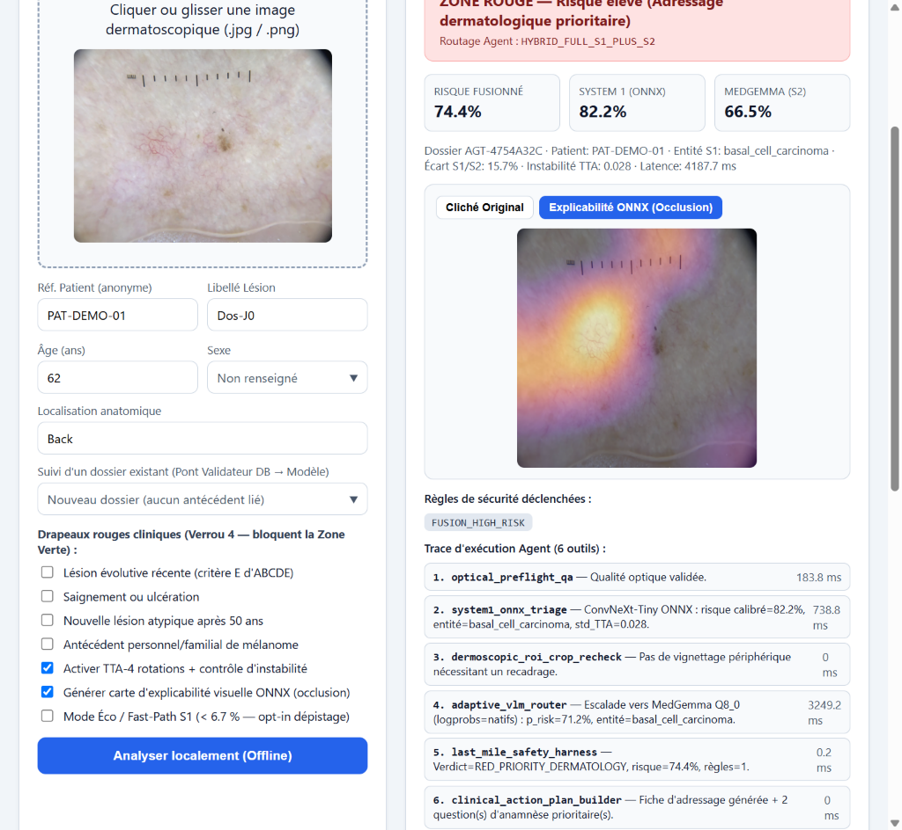
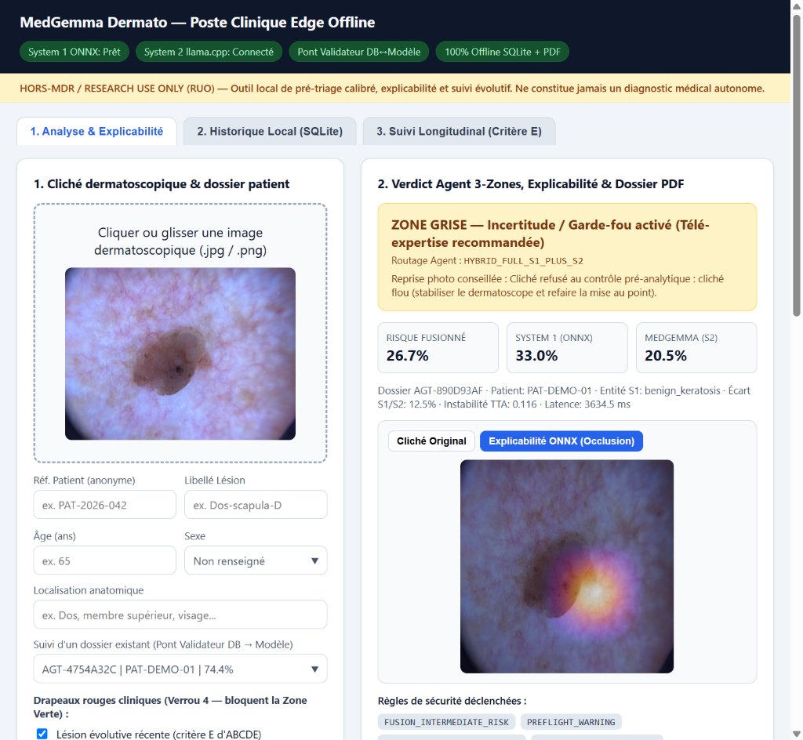
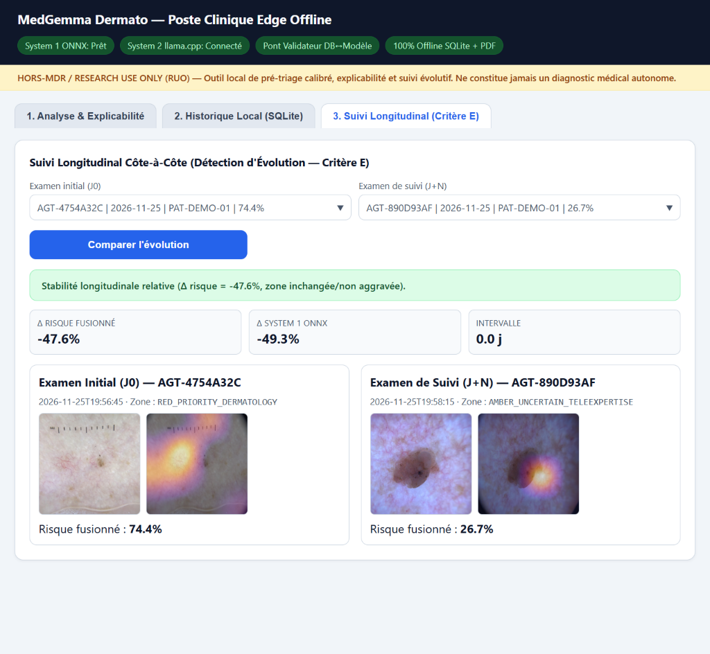
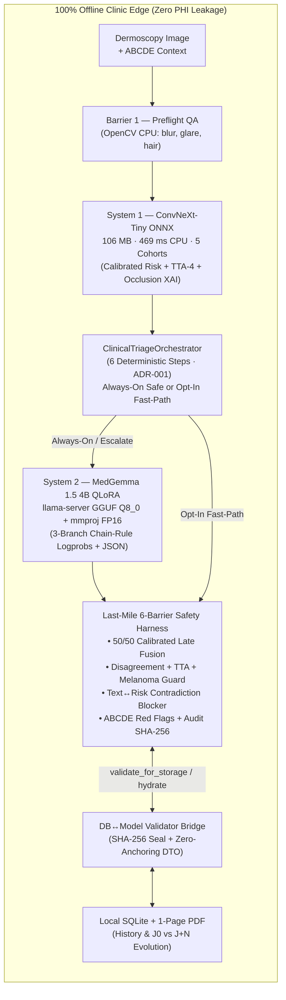
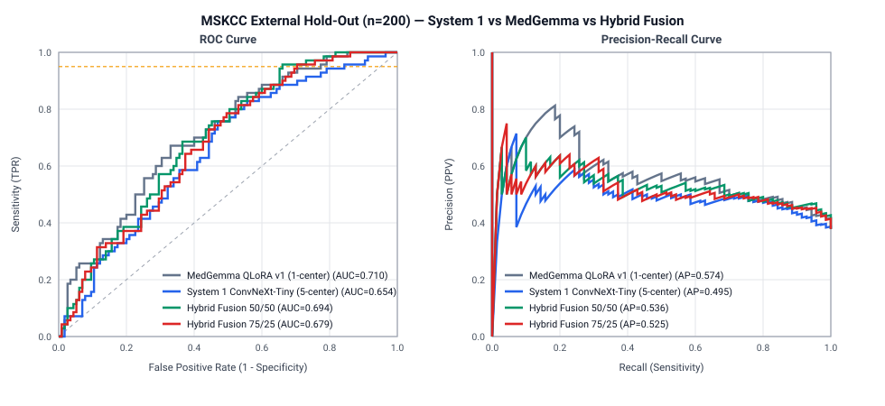

# MedGemma 1.5 4B — Offline Edge Clinical Triage & Last-Mile Safety Harness

> **Language:** **English** | [Français (README.fr.md)](README.fr.md)  
> **Regulatory Scope — Research Use Only (RUO / Non-MDR):** This repository is an architectural and clinical AI safety demonstrator (*pre-analytical optical QA*, calibrated 3-zone pre-triage, visual explainability, and structured GP referral drafting). It is **not** a certified medical device (EU MDR Class IIa) and never issues autonomous diagnoses. Base weights (`google/medgemma-1.5-4b-it`) are subject to the **Google Health AI Developer Foundations (HAI-DEF)** license terms.

A **100% offline Edge clinical workstation** combining a lightweight multi-center ONNX vision screener (**System 1: `ConvNeXt-Tiny`**, `106 MB`, zero PyTorch at runtime), a fine-tuned multimodal medical VLM (**System 2: `MedGemma 1.5 4B QLoRA`**, exported to `GGUF Q8_0` with **3-branch chain-rule native logprobs**), a **bidirectional SHA-256 SQLite ↔ Model Validator Bridge**, and a **6-barrier deterministic Safety Harness** evaluated blind on an unseen external hospital biopsy cohort (**MSKCC Consecutive Biopsies 2020, `n=200`**).

---

## Live Edge UI Preview (100% Offline, Local RTX 4080 + SQLite + PDF)

| Tab 1: Red Zone + ONNX Occlusion XAI + 6-Step Trace | Tab 1: DB↔Model Bridge Follow-Up (`AMBER` Escalation) | Tab 3: Longitudinal Comparison (ABCDE Evolution) |
| :---: | :---: | :---: |
|  |  |  |

---

## Three Engineering Decisions That Define This System

1. **Catching Silent 4-Bit Clinical Collapse (`Q4_K_M` Rejected by CI/CD Gate):** Quantizing MedGemma 1.5 4B to `Q4_K_M` keeps **`100.0%` valid JSON** and clean-looking ECE (`0.164`), yet silently drops malignant sensitivity by **`-31.4 pts`** (`75.7% → 44.3%`, missing over half of melanomas). Standard format/perplexity checks miss this completely; our policy-as-code `DeploymentGate` blocks it automatically.
2. **Bounded Deterministic Orchestration Over Unconstrained LLM Loops ([ADR-001](docs/ADR_001_deterministic_orchestration.md)):** As a certified *Google Cloud Professional Agentic Architect*, critical clinical routing is implemented as a deterministic, auditable 6-step pipeline (`ClinicalTriageOrchestrator`) — never an autonomous ReAct loop — guaranteeing that preflight QA, TTA instability checks, ABCDE red flags, and contradiction blockers cannot be skipped under prompt pressure.
3. **Bidirectional SQLite ↔ Model Format Validator ([`db_model_bridge.py`](src/medgemma_dermato/db_model_bridge.py)):** Every stored exam is wrapped in a `schema_version="2.0"` envelope sealed with a canonical **SHA-256 integrity digest**. When linking a follow-up visit, the bridge strips PII (`patient_ref`, free-text clinician notes) and Jinja/control injection tokens, isolates prior verdicts from MedGemma's prompt to prevent **anchoring bias**, and passes `LongitudinalPriorDTO` strictly to deterministic post-inference rules (`LONGITUDINAL_BRIDGE_EVOLUTION`).

---

## 1. System Architecture



---

## 2. Blind External Hospital Results (`MSKCC 2020`, `n=200`)

**Strict Anti-Leakage Protocol:** `google/medgemma-1.5-4b-it` pre-training included ISIC 2017/2018 `CC-0` images, so all 2017/2018/HAM10000 collections are excluded from test. Our locked external hold-out (`data/isic_v1/test.jsonl`, **Collection 163 — MSKCC Consecutive Biopsies 2020**, `100% CC-BY`) contains **`70` malignancies** (`39` melanomas incl. `19` *in situ*, `19` SCC, `12` BCC), **`115` biopsied benign mimics** (lesions that already fooled expert dermatologists), and **`15` indeterminate** lesions. **Zero MSKCC images/patients/lesions** appear in training or calibration (`T`, `τ` fitted strictly on `val`).

### 2.1 End-to-End Progression (Zero-Shot → QLoRA → BF16 Option C → Local RTX 4080 `Q8_0`)

| Configuration | AUROC | Malignant Sens. | Melanoma Sens. | Green Spec. | Green NPV | ECE | Contradictions Blocked | CI/CD Gate |
|---|---:|---:|---:|---:|---:|---:|---:|---|
| 1. MedGemma 1.5 Zero-Shot (Neutral) | — | `20.0%` (`14/70`) | `17.9%` (`7/39`) | `90.4%` | — | `0.2950` | — | `BLOCK` |
| 2. MedGemma QLoRA v1 (BF16 Greedy, HIBA) | — | `75.7%` (`53/70`) | `76.9%` (`30/39`) | `52.2%` | — | `0.1863` | — | `BLOCK` |
| 3. MedGemma QLoRA v1 (BF16 Chain-Rule `@val95%`) | **`0.7096`** | `81.4%` (`57/70`) | `82.0%` (`32/39`) | `47.8%` | `80.9%` | `0.1959` | — | `BLOCK` |
| 4. System 1 `ConvNeXt-Tiny` ONNX (5-center `@mc_val95%`) | `0.6537` | `84.3%` (`59/70`) | `87.2%` (`34/39`) | `39.1%` | `80.4%` | `0.2280` | — | `BLOCK` |
| **5. Hybrid BF16 (50/50) + Last-Mile Harness** | `0.6944` | **`95.7%`** (`67/70`) | **`97.4%`** (`38/39`) | **`30.4%`** (`35/115`) | **`92.1%`** | `0.1737` | **`43` (`14` cancers)** | **`PASS`** |
| 6. Edge `Q8_0` 1-Pass Logprobs + ONNX + Harness (RTX 4080) | `0.6920` | `91.4%` (`64/70`) | `94.9%` (`37/39`) | `27.8%` (`32/115`) | `84.2%` | `0.1676` | **`57` (`15` cancers)** | `BLOCK` |
| **7. Edge `Q8_0` 3-Branch Logprobs + ONNX + Harness (RTX 4080)** | `0.6976` *(S2 `0.7022`)* | `91.4%` (`64/70`) | `94.9%` (`37/39`) | **`30.4%`** (`35/115`) | `85.4%` | **`0.1594`** | **`52` (`15` cancers)** | **`BLOCK`** |

> **Honest CI/CD Gate Governance:** On RTX 4080 (`0.00 CU` Colab, `3.4 s/case`), **3-branch KV-cached marginalization** in [`edge_vlm.py`](src/medgemma_dermato/edge_vlm.py) pushes standalone `Q8_0` AUROC to `0.7022` (`0.9446` on HIBA val), achieves the project's **best calibration (`ECE = 0.1594`)**, and restores full `30.4%` Green Specificity — while the CI/CD gate intentionally stays at `BLOCK_DEPLOY` (`91.4% < 95.0%` floor due to 8-bit quantization margin compression on 6 borderline cases).

### 2.2 Sprint 4 — GGUF Quantization Non-Regression (`mmproj` FP16 `811.8 MB`)

| Model | Total Size | Valid JSON | Safe Triage Sens. | Melanoma Sens. | Specificity | Latency (L4) | Gate Verdict |
|---|---:|---:|---:|---:|---:|---:|---|
| `BF16 Merged` (Reference) | `~8.5 GB` | `100.0%` | `75.7%` | `76.9%` | `52.2%` | `7,583 ms` | Reference |
| **`GGUF Q8_0 + mmproj FP16`** | **`4.76 GB`** | `99.5%` | `70.0%` (`-5.7 pts`) | `69.2%` | **`61.7%`** | `2,784 ms` | Minimum safe floor |
| **`GGUF Q4_K_M + mmproj FP16`** | `3.19 GB` | **`100.0%`** | **`44.3%` (`-31.4 pts`)** | **`43.6%`** | `74.8%` | `2,033 ms` | **REJECTED / BLOCKED** |

### 2.3 Adversarial Red-Teaming (`13/13 PASS`) & Curves

[`scripts/run_adversarial_stress_test.py`](scripts/run_adversarial_stress_test.py) verifies **`13/13` (`100.0%`)** adversarial barriers: optical corruptions (Gaussian blur, specular glare, hair, exposure extremes, poor framing), epistemic disagreement & TTA instability, melanoma sub-score guard, text-vs-risk contradiction blocker, RUO regex sanitizer, ABCDE red-flag overrides, schema & `Q4_K_M` gate rejection, and real ONNX perturbation stability (`JPEG-35 drift = 0.0550`, `white-balance drift = 0.0407`).

| QLoRA Training Curves | Hybrid ROC & PR (`MSKCC n=200`) | 3-Zone Harness Distribution |
| :---: | :---: | :---: |
|  |  |  |

---

## 3. Zero-Friction Quickstart (No HTTP 503 on Clone)

```powershell
# 1. Install package + dev & Edge Cabinet dependencies
uv venv --python 3.12
uv pip install --python .venv\Scripts\python.exe -e ".[dev,edge]"

# 2. Run lint & all 47 unit/integration/adversarial tests
.venv\Scripts\ruff.exe check src scripts tests app
.venv\Scripts\pytest.exe tests -v

# 3. Download open CC-0/CC-BY System 1 ConvNeXt-Tiny ONNX weights (106 MB, optional — Demo Sandbox runs without it)
.venv\Scripts\medgemma-dermato.exe download-system1

# 4. Launch 1-click supervised Edge Cabinet UI (auto-starts local llama-server Q8_0 if present, else System 1 / Sandbox)
.venv\Scripts\medgemma-dermato.exe serve --open
# Or via Docker:
docker compose up --build
```

---

## 4. Explicit Clinical Limitations

1. **Skin Tone Bias (Fitzpatrick V–VI):** Public ISIC cohorts strongly under-represent darker skin phototypes; no clinical generalization is claimed without dedicated prospective validation.
2. **Spectrum Bias (MSKCC Biopsied Cohort):** `100%` of MSKCC benign lesions are hard mimics already selected for biopsy — systematically lowering apparent AUROC vs general screening (`0.93–0.98` across HIBA/DERM12345).
3. **Edge `Q8_0` Gate:** Pure Edge `Q8_0` (v1) remains intentionally gated at `BLOCK_DEPLOY` (`91.4% < 95.0%`), whereas BF16 Option C passes at `95.7%` malignant / `97.4%` melanoma.
4. **Regulatory Status:** Strictly **RUO / Non-MDR** decision-support demonstrator.

---

## 5. Repository Structure

```text
├── app/                         # Offline FastAPI Cabinet App + 3-Tab UI (index.html)
├── configs/project.yaml         # Centralized splits, preflight, QLoRA & eval config
├── docs/
│   ├── ADR_001_deterministic_orchestration.md  # PAA Architecture Decision Record
│   └── assets/                  # Verified UI screenshots & SVG evaluation charts
├── Dockerfile & docker-compose.yml # Production containerization + optional llama.cpp VLM
├── scripts/                     # ISIC ingestion, QLoRA v1/v2, System 1 ONNX, GGUF & red-team benchmarks
├── src/medgemma_dermato/
│   ├── preflight.py             # Barrier 1: OpenCV pre-analytical QA + ROI crop
│   ├── system1.py               # Zero-PyTorch ONNX Runtime + TTA-4 instability
│   ├── explainability.py        # Single-batch ONNX occlusion saliency heatmap
│   ├── edge_vlm.py              # llama-server client with 3-branch chain-rule logprobs
│   ├── agent.py                 # ClinicalTriageOrchestrator (6 deterministic steps)
│   ├── clinical_harness.py      # 6-barrier Last-Mile Safety Harness + DeploymentGate
│   ├── db_model_bridge.py       # Bidirectional SQLite <-> Model SHA-256 Format Validator
│   ├── storage.py & pdf_report.py # Local SQLite longitudinal store + 1-page referral PDF
│   └── launcher.py              # `medgemma-dermato` CLI (`serve` & `download-system1`)
└── tests/                       # 47 unit, bridge, API, PDF, XAI & adversarial tests (CI green)
```
