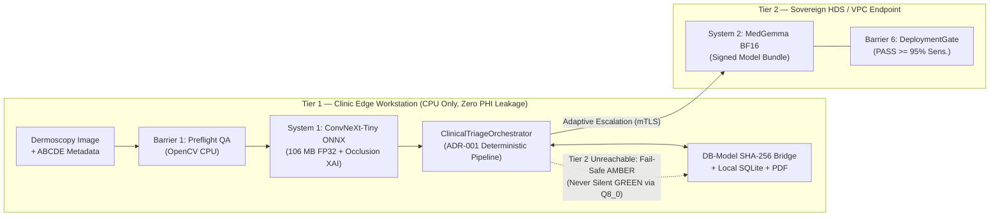

# ADR-002: Tiered Production Topology, Signed Model Bundles & Decoupling VLMs from Critical Scoring

- **Status:** Accepted
- **Role Perspective:** AI Solutions Architect / Google Cloud Professional Agentic Architect (PAA)
- **Components:** `LastMileClinicalHarness` (`src/medgemma_dermato/clinical_harness.py`), `scripts/verify_policy_gates.py`, `configs/reference_gate_snapshots.json`, Edge/HDS Deployment Topology

## Context

On the locked blind external hospital cohort (**MSKCC Consecutive Biopsies 2020, `n=200`**, `70` malignancies / `39` melanomas / `115` biopsied benign mimics / `15` indeterminate), our Policy-as-Code release gate (`evaluate_deployment_gate` in `src/medgemma_dermato/clinical_harness.py`) enforces five mandatory clinical safety floors (`json_valid_rate >= 99%`, `malignant_safe_sensitivity >= 95%`, `melanoma_safe_sensitivity >= 95%`, `green_zone_npv >= 90%`, `green_zone_benign_specificity >= 20%`):

- **BF16 Hybrid 50/50 + Harness:** `PASS` (`95.7%` malignant `67/70`, `97.4%` melanoma `38/39`, `92.1%` Green NPV, `30.4%` Green specificity).
- **GGUF `Q4_K_M`:** `BLOCK_DEPLOY` (`44.3%` malignant `-31.4 pts` silent collapse despite `100.0%` valid JSON).
- **Edge `v1 Q8_0` & multi-center `v2 Q8_0` (3-branch):** `BLOCK_DEPLOY` (`91.4%` malignant `64/70`, `94.9%` melanoma `37/39`). Even though multi-center `v2 Q8_0` strictly improves every calibration and specificity metric (`100.0%` valid JSON, `36.5%` Green specificity, `87.5%` Green NPV, best `ECE = 0.1192`, and `62` text-vs-risk contradictions blocked incl. `23` cancers), it still misses `6` malignancies (`3` short of the `>= 95%` floor).

A post-mortem architectural audit of those `6` false negatives and our fusion sweeps exposes four structural lessons:

1. **Risk-Adjusted TCO vs. Quantization Compression:** Compressing System 2 into 8-bit Edge weights to save shared server GPU spend misses `3` additional cancers out of `70` (including `1` melanoma). In clinical triage, that compute saving is negative ROI under medical-legal and patient-safety risk.
2. **Implicit Policy-to-Weights Coupling (Configuration Drift):** `HarnessPolicy` in `src/medgemma_dermato/clinical_harness.py` currently decouples calibration and routing constants (`tau_green_max = 0.1753`, `temp_medgemma = 1.3185`, fitted on `v1 BF16`) from model weight artifacts. Furthermore, fitting `T = 0.6503 < 1.0` on in-distribution HIBA validation (`AUROC 0.9509`) sharpened sub-`0.50` OOD probabilities downward, degrading MSKCC standalone MedGemma ECE (`0.0660 -> 0.1164`) and Brier (`0.2139 -> 0.2264`) and pushing `ISIC_7883190` (`p_fused = 0.169 < 0.1753`) into `GREEN`.
3. **Why Raising System 1 Weight Fails OOD (Error Orthogonality > Parameter Count):** Weight sweeps on `MSKCC n=200` (`outputs/system1_fusion/fusion_summary.json`) show that increasing `System 1` (`ConvNeXt-Tiny`, ImageNet-pretrained) weight monotonically degrades external generalization:
   - `w_s1 = 0.50` (`equal_50_50`): `AUROC 0.6944`, **`95.7%` malignant (`67/70`)**, **`97.4%` melanoma**, **`92.1%` NPV** -> `PASS`
   - `w_s1 = 0.75` (`multicenter_75_25`): `AUROC 0.6791`, `90.0%` malignant (`63/70`), `92.3%` melanoma, `84.4%` NPV -> `BLOCK_DEPLOY`
   - `w_s1 = 0.85` (`multicenter_85_15`): `AUROC 0.6734`, `87.1%` malignant (`61/70`), `89.7%` melanoma, `81.2%` NPV -> `BLOCK_DEPLOY`
   - `w_s1 = 0.98` (`val_nll_blend`): `AUROC 0.6583`, `84.3%` malignant (`59/70`), `87.2%` melanoma, `80.0%` NPV -> `BLOCK_DEPLOY`
   Neither `ConvNeXt-Tiny` alone (`AUROC 0.9604` internal -> `0.6537` MSKCC, `84.3%`) nor `MedGemma BF16` alone (`AUROC 0.7096`, `81.4%`) passes. The `+11 to +14 pt` leap comes from **error orthogonality** between a local CNN and a medical-pretrained vision encoder — not from MedGemma's 3.6B language decoder.
4. **Blind Hold-Out Freeze:** Nine configurations have already been evaluated against `MSKCC n=200`. Further model tuning against this cohort risks adaptive test-set overfitting.

## Decision

We adopt three binding architectural decisions driven directly by Barrier 6's `BLOCK_DEPLOY` signal:

### 1. v2 Tiered Production Topology (Edge CPU + Sovereign HDS/VPC `BF16`)

Pure local `Q8_0` remains permanently gated at `BLOCK_DEPLOY` for autonomous green-zone triage (restricted to RUO demonstration and shadow-logging). Production clinical deployment uses a **two-tier topology**:

- **Fail-Safe Offline Degradation:** If Tier 2 (`BF16`) is unreachable during a consultation, Tier 1 **never** falls back silently to `Q8_0` to clear a lesion as `GREEN`. It degrades explicitly to `AMBER_UNCERTAIN_TELEEXPERTISE` (queued for asynchronous specialist review).

### 2. Immutable Signed Model Bundle Contract

Replace loose weights + static `HarnessPolicy` defaults with one atomic, cryptographically signed release artifact verified in CI/CD:
- Bundle contents: `(weights_sha256, calibration_manifest, decision_thresholds, loho_cv_metrics, gate_verdict)`.
- **Calibration Constraint:** Enforce `temperature >= 1.0` for clinical OOD inference to prevent in-distribution probability sharpening (`T < 1.0`) from compressing borderline malignancies into `GREEN`.

### 3. v3 EU MDR / SaMD Target Architecture: Decouple VLMs from Critical Scoring

For future regulated clinical productization (EU MDR Class IIa / FDA SaMD):
- **Critical Scoring Path (Deterministic CPU Ensemble `< 120M` params):** Replace the 4B VLM on the scoring path with a heterogeneous ensemble of two complementary FP32 vision encoders (lightweight CNN + medical self-supervised ViT, e.g., Derm Foundation / PanDerm class) plus a tabular metadata head (age, anatomical site, ABCDE evolution), eliminating GPU requirements, quantization collapse, and JSON/logprob parsing.
- **Zero-Leakage Ensemble Calibration:** Fit fusion weights and operating thresholds strictly via **Leave-One-Hospital-Out (LOHO)** cross-validation — never via pooled in-distribution NLL optimization (`val_nll_blend`).
- **Asynchronous VLM Narrative Layer:** Restrict generative VLMs/LLMs strictly to non-critical ergonomic workflows (semiologic summary drafting, EHR/DMI pre-fill, GP referral letters), hard-bound by Barrier 3 so generated prose can never contradict or soften the discriminant triage zone.

## Consequences

- **Positive:** Turns `BLOCK_DEPLOY` into an actionable topology & FinOps decision; eliminates `HarnessPolicy` configuration drift via Signed Model Bundles; establishes a realistic EU MDR / HDS certification roadmap while preserving `MSKCC n=200` integrity.
- **Trade-offs:** Tier 2 `BF16` introduces a network dependency for final `GREEN` clearance on escalated cases, mitigated by explicit `AMBER` fail-safe degradation.
- **Governance Rule:** `MSKCC n=200` is permanently frozen as the `v1/v2` reference benchmark. Any future `v3` pure-vision ensemble must be evaluated on a **new, untouched external hospital cohort**.
